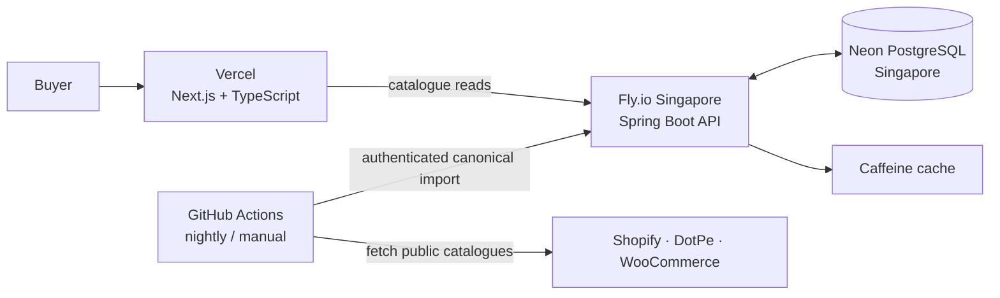

# KitPaglu

**A full-stack football-kit discovery platform that makes fragmented retailer catalogues searchable, comparable and easier to browse.**

[Live demo](https://kitpaglu.vercel.app) · [Architecture](docs/ARCHITECTURE.md) · [Deployment](docs/DEPLOYMENT.md)

KitPaglu aggregates publicly exposed catalogue data from Indian football-kit retailers, normalises products and variants, and sends buyers to the original seller to complete a purchase. It is a discovery and comparison service—not a marketplace—and does not handle checkout, payments, inventory, shipping or returns.

## Why it is interesting

Retailer catalogues are inconsistent: one store may be Shopify, another WooCommerce, and another a custom Next.js/DotPe storefront. Product options can represent a size, player name, patch or a default title; price and availability can vary per size; and a failed partial refresh must never make a whole store disappear.

KitPaglu solves those problems behind a canonical product/variant model, then provides one consistent search experience across the stores it tracks.

## Highlights

- Aggregates **11 retailer sources** across **Shopify, WooCommerce and DotPe/Next.js**.
- Preserves variant-level **size, price, MRP/reference price and availability**.
- Offers URL-shareable search, multi-select filters, clearance, seller-date arrivals, seller-varied mixed picks and discount comparisons.
- Makes imports **idempotent** with stable external IDs, in-place variant updates, soft delists and a partial-fetch safety guard.
- Records every refresh with source, timestamps, counts, status and error details for operational visibility.
- Uses browser-local favourites: no account or personal data is required.

## Architecture



### Read path

Next.js server-renders the first catalogue view through the Spring API. Subsequent filtering and pagination use the same public API. Spring Data JPA Specifications compose optional text, store, size, version, price, stock and clearance filters; Caffeine caches repeated read queries and successful imports invalidate those entries.

### Ingestion path

1. The GitHub Actions worker reads enabled sources from the protected registry.
2. A platform adapter fetches and maps source products into `RawProduct` / `RawVariant`, retaining usable records if a later request fails.
3. The worker uploads the canonical payload to the API; the worker never receives database credentials.
4. Spring Boot validates and normalises the data, synchronises products/variants transactionally, conditionally soft-delists absent listings, records a run, then clears cache entries.

See the [architecture guide](docs/ARCHITECTURE.md) for HLD/LLD diagrams, data model and operational runbook.

## Technology

| Layer | Technology | Reason |
|---|---|---|
| Web | Next.js 16, TypeScript, Tailwind CSS | Server-rendered initial experience with responsive, interactive filters. |
| API | Java 21, Spring Boot 3, Gradle | Typed domain model, transactional workflows, validation and mature web tooling. |
| Data | PostgreSQL on Neon, Flyway, Spring Data JPA | Relational product/variant integrity, indexes, migrations and query composition. |
| Ingestion | Node.js, GitHub Actions | Nightly public-source fetching from a separate egress environment, with protected API uploads. |
| Hosting | Vercel, Fly.io, Neon | Purpose-fit frontend hosting, always-on Docker API and managed Postgres. |

## Data correctness decisions

- **Product identity:** `(store_id, external_id)` is unique, so repeated imports update rather than duplicate cards.
- **Variant identity:** `(product_id, external_id)` is unique; variants update in place to avoid ORM lifecycle collisions.
- **Price integrity:** sale price and MRP come from the same selected variant, preventing misleading discounts.
- **Stock integrity:** a `size=M` + `in stock` query must match an available M variant—not merely an available size elsewhere on the product.
- **Safe removals:** explicitly incomplete catalogues, empty imports, and fetched counts below half of a store's previous active catalogue are marked `PARTIAL`; they cannot soft-delist unseen products.
- **Seller-new arrivals:** `source_created_at`, rather than local ingestion time, determines latest arrivals. Listings without a reliable seller date follow dated listings.

## Local development

### Prerequisites

- Java 21
- Node.js 22+ and npm
- Docker Desktop (for local PostgreSQL)

### 1. Start PostgreSQL

```bash
docker compose up -d
```

### 2. Start the backend

```bash
cd backend
./gradlew bootRun
```

The API starts on `http://localhost:8080`; Flyway creates and migrates the schema automatically.

### 3. Start the frontend

```bash
cd frontend
cp .env.example .env.local
npm ci
npm run dev
```

Open `http://localhost:3000`.

The tracked [`frontend/.env.example`](frontend/.env.example) contains local public URLs only. Do not commit `.env.local`, provider credentials, `ADMIN_TOKEN`, or production database values.

## Verification

```bash
cd backend && ./gradlew test
npm --prefix frontend run build
node --test scripts/refresh-catalogues.test.mjs
```

Backend tests cover product normalisation, price calculation, size/version classification, source mapping and idempotent variant synchronisation. The frontend production build validates routes and TypeScript compilation.

## Source integrations and responsible use

The project reads only public catalogue endpoints. Requests identify the client, are time-bounded and paced, and source failures are isolated so a single retailer cannot block the remaining catalogue refreshes. If a seller asks to be removed, their source should be disabled and existing listings deactivated through an audited operator action.

Public product images and outbound product links remain the seller's content. Prices and availability are indicative and must be confirmed on the seller's site. KitPaglu is not affiliated with any retailer.

## Deployment

The deployed setup is:

- **Frontend:** Vercel
- **Backend:** one always-on Fly.io Spring Boot machine in Singapore
- **Database:** Neon PostgreSQL in Singapore
- **Catalogue refresh:** GitHub Actions at 03:00 IST, with manual single-store or all-store dispatch

Operational configuration is supplied as Fly/Vercel/GitHub Actions secrets. The deployment checklist and coordinated API/frontend release order are documented in [docs/DEPLOYMENT.md](docs/DEPLOYMENT.md).

## Project documentation

- [Architecture](docs/ARCHITECTURE.md) — HLD, LLD, Mermaid diagrams, data model and operational runbook.
- [Deployment](docs/DEPLOYMENT.md) — production setup and release runbook.
- [Catalogue failure RCA](docs/CATALOGUE-FAILURE-RCA.md) — recent failure evidence, partial-sync safeguards and rollout order.
- [Product requirements](docs/PRD.md) — product scope and acceptance criteria.

## Public-repository checklist

This repository intentionally contains no production credentials. Before publishing a fork or deployment, configure your own database, host, frontend origin and GitHub Actions secrets. Do not reuse the live Fly app identifier or any production endpoints for a new deployment.

No open-source licence has been selected yet. A repository can be public without a licence, but contributors receive no permission to reuse or modify the code by default. Add a licence (commonly MIT for a portfolio project) only when the maintainer is ready to grant those rights.
