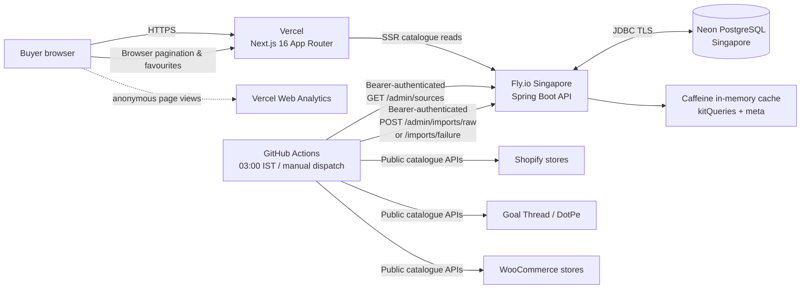
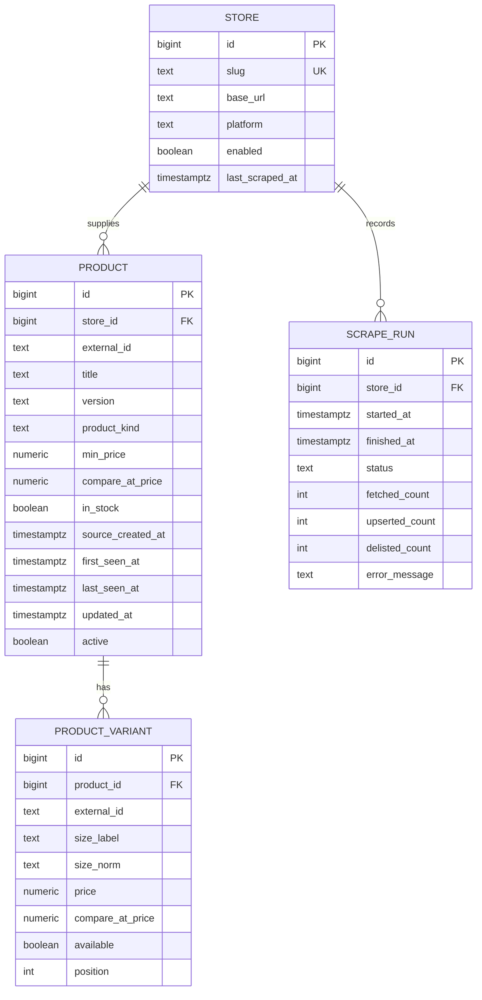
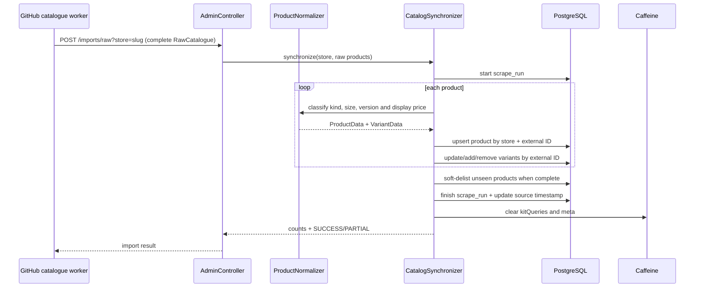

# KitPaglu Architecture

**Status:** Current implementation reference  
**Last updated:** 2026-08-01

KitPaglu is a read-heavy football-kit discovery and comparison application. It aggregates publicly exposed product catalogues, normalises listings and variants, and sends a buyer to the original seller to purchase. It does not own stock, take payments, or store end-user accounts.

The original design plan in [`../plan.md`](../plan.md) remains useful as project history, but this document is the source of truth for the implemented high-level design (HLD) and low-level design (LLD).

## 1. High-level design

### Deployed components

| Component | Runtime | Responsibility |
|---|---|---|
| Web | Next.js 16, Vercel | Server-renders the initial catalogue; handles filter UI, pagination and local-only favourites. |
| API | Java 21, Spring Boot 3, Fly.io (`sin`) | Public read API, authentication for operator endpoints, normalisation, catalogue sync, run history and cache invalidation. |
| Database | Neon PostgreSQL (`ap-southeast-1`) | Stores sources, products, variants and every refresh run. Flyway controls schema evolution. |
| Catalogue worker | GitHub Actions + Node.js | Runs nightly and on manual dispatch; reads the source registry, fetches public store data and sends canonical catalogue payloads to the API. |
| Analytics | Vercel Web Analytics | Cookie-free page views and daily unique visitors. It is not coupled to the application database. |

### Read path

1. A browser requests `kitpaglu.vercel.app`.
2. A Next.js Server Component calls `GET /api/v1/kits` and `GET /api/v1/stores` on the Spring API. Browser pagination uses the same public API.
3. `KitQueryService` first checks Caffeine. On a miss, it builds JPA Specifications from optional search, store, size, version, stock, clearance and price filters.
4. The API reads PostgreSQL, maps products to compact card DTOs, and caches the result for up to 15 minutes.
5. Filter state is encoded in the URL. Favourites are deliberately isolated in `localStorage` under a versioned key and are never sent to the backend.

### Write path

1. The GitHub Action gets all enabled sources from `GET /api/v1/admin/sources`.
2. A platform adapter fetches that source's public Shopify, DotPe or WooCommerce catalogue and maps it to canonical `RawProduct` and `RawVariant` objects.
3. The worker posts the complete catalogue atomically to `POST /api/v1/admin/imports/raw?store={slug}`. A fetch-side failure is recorded through `POST /api/v1/admin/imports/failure`.
4. The API normalises each product, upserts it and updates variants by their stable external IDs. It does not delete and recreate unchanged variants.
5. If the fetched count is at least 50% of the prior active count, products not seen in this completed run are soft-delisted (`active=false`). Smaller responses are marked `PARTIAL` and cannot delist the existing catalogue.
6. The API writes a `scrape_run`, updates `store.last_scraped_at`, and clears catalogue/meta caches.

Each source is isolated. A failed store is logged and persisted without blocking imports for subsequent stores; the Action ends non-zero after all sources have had a chance to run.

## 2. Low-level design

### Core data model

Database invariants:

- `product(store_id, external_id)` is unique, making product imports idempotent.
- `product_variant(product_id, external_id)` is unique. Variants update in place by that external ID, avoiding the JPA orphan-removal insert/delete ordering problem.
- `first_seen_at` never changes; `last_seen_at` advances when a product appears in a successful import; `updated_at` changes on a local product-state change, including a soft delist.
- Products are never hard-deleted during a normal import. `active=false` preserves history and lets a relisted product reactivate with the same ID.

### Normalisation pipeline

### Search, sorting and product correctness

| Concern | Implementation |
|---|---|
| Text search | Accent-insensitive normalised title/tag search using PostgreSQL trigram indexing. |
| Filters | JPA Specifications compose optional filters; repeated size/store/version values use OR within each filter while filter groups combine with AND. |
| Size + stock | The size and availability predicate applies to the same `product_variant`, so an out-of-stock M cannot qualify because XL is available. |
| Display price | Lowest available variant price; otherwise lowest variant price. Any MRP/reference price is taken from that same display variant. |
| Default sort | `latest_arrivals`: in-stock first, then seller `source_created_at` descending with missing dates last, then ID descending. It never treats local ingestion time as a seller arrival time. |
| Mixed picks | Product cards are grouped into stock/image-quality tiers and deterministically shuffled, then round-robin interleaved by seller. |

### Source adapters

| Platform | Worker behaviour | Current use |
|---|---|---|
| Shopify | Reads paginated `/products.json`; finds the option literally named `Size`. | Full Time Store, The Football Frenzy, Shop Ezzy, Store 1914, Gully Sports, Campeon Sports, Jersey Hut and Kitkrew. |
| DotPe / Next.js | Reads product sitemap, discovers the current Next.js build ID, fetches product JSON and refreshes the build ID once after a 404. | Goal Thread. |
| WooCommerce | Reads public Store API parent and variation collections; converts minor-unit prices and groups variants by parent. | JC Club and Outhouse Athleisure. |

A new Shopify or WooCommerce source only needs an enabled `store` row; the worker discovers it automatically. A genuinely new platform requires one worker adapter that maps into `RawProduct`/`RawVariant`, not a rewrite of the sync pipeline.

## 3. Security, privacy and operations

- Public browser CORS is limited to `GET` catalogue, store and metadata endpoints from the configured Vercel origin.
- All `/api/v1/admin/**` endpoints require `Authorization: Bearer <ADMIN_TOKEN>`; the token exists only in Fly and GitHub Actions secrets.
- Database credentials and tokens are runtime secrets, never committed.
- Outbound product links open on the seller site with `noopener nofollow sponsored`.
- Vercel Web Analytics is separate, cookie-free and anonymous. Do not send personal data through analytics events or URL query parameters.
- Fly runs one always-on 1 GB shared-CPU machine in Singapore with readiness checks. Neon is also in Singapore to reduce database latency.
- GitHub Actions is the production scheduler; set `KITRADAR_REFRESH_CRON=-` on Fly to prevent the in-process Spring scheduler from duplicating the nightly run.

## 4. Operational runbook

| Need | Action |
|---|---|
| Check API availability | `GET /actuator/health/readiness` should return `UP`. |
| Run every source | Dispatch **Nightly catalogue refresh** in GitHub Actions and leave `store` blank. |
| Run one source | Dispatch the same workflow with the exact store slug. |
| Inspect refresh history | `GET /api/v1/admin/runs?store={slug}` with the bearer token. |
| Remove a seller | Use an audited migration/operator operation to set the source `enabled=false` **and** its products `active=false`; disabling alone prevents future imports but intentionally preserves existing listings for audit history. |
| Add a Shopify/WooCommerce seller | Verify its public API, add an idempotent Flyway seed/upsert row, deploy Fly, then run the blank workflow. |
